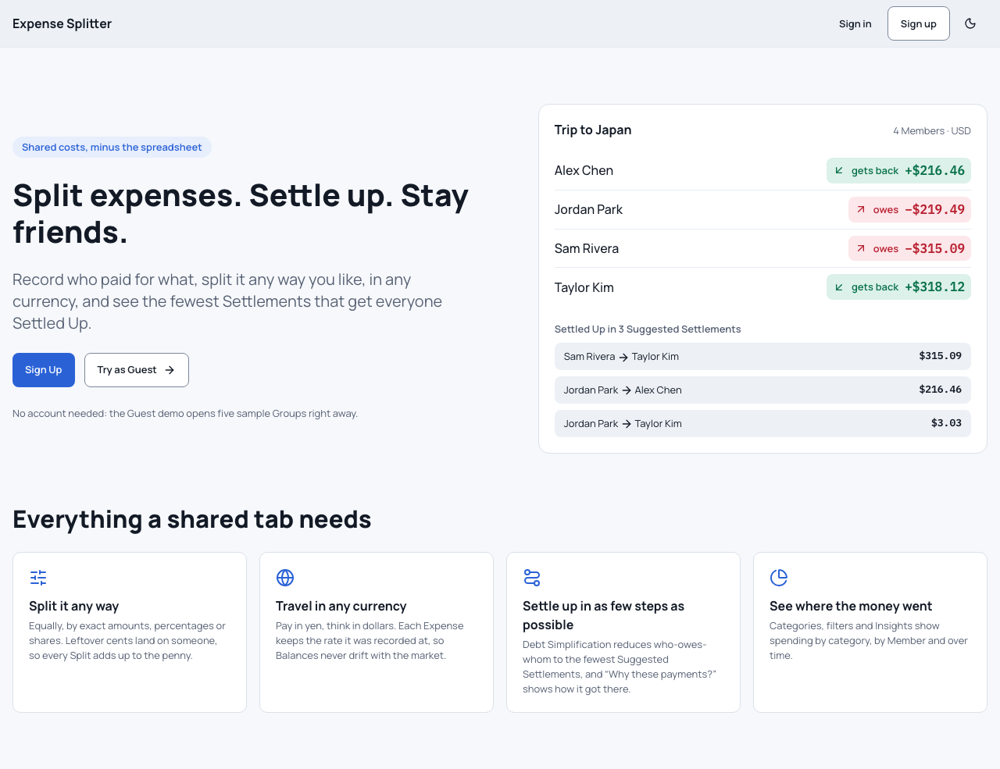
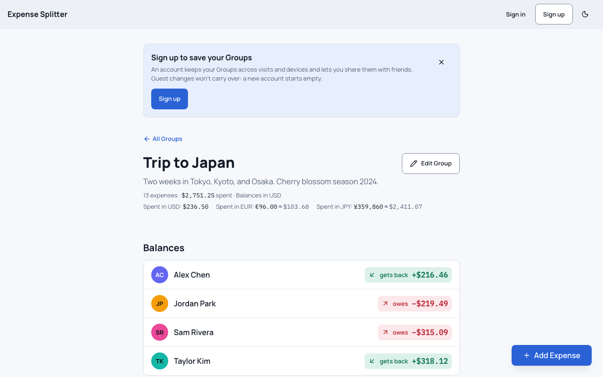
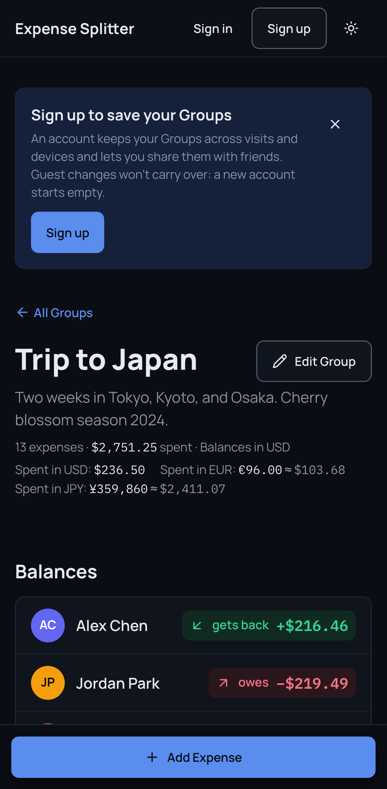

# Expense Splitter: Josh Liu

[](https://github.com/JoshLiu111/expense-splitter/actions/workflows/ci.yml)

A group expense-splitting app with multi-currency support, flexible split types, and clear settlement tracking.

**Challenge:** [Expense Splitter on Frontend Mentor](https://www.frontendmentor.io/challenges/expense-splitter)

**Live URL:** https://expense-splitter-fawn.vercel.app · **Try it without an account:** [/guest](https://expense-splitter-fawn.vercel.app/guest)



| Group dashboard | Phone, dark theme |
|---|---|
|  |  |

---

## Overview

Expense Splitter records who paid for what in a Group, splits each Expense equally, by exact amounts, percentages or shares, and shows every Member a Balance they can trust: amounts are integer minor units, every Leftover Cent is assigned, and Balances always sum to zero. Expenses can be paid in any currency and keep the Locked Rate they were recorded at. Settling up uses Debt Simplification to propose the fewest Suggested Settlements, and "Why these payments?" explains how they were derived.

Visitors can try everything at [`/guest`](https://expense-splitter-fawn.vercel.app/guest) with five sample Groups (travel, roommates, office lunch, a birthday present, a camping trip). Guest changes last for the browser session; a gentle, dismissible prompt invites Guests to sign up, and says plainly that Guest data won't carry over. Signed-in Users get real accounts (email verification, password reset) and Groups shared with other Users by email.

### Tech stack

| Layer | Technology |
|-------|-----------|
| Framework | Next.js 16 (App Router, Server Actions), React 19, TypeScript |
| Database | Postgres (Neon) via Drizzle ORM |
| Authentication | Better Auth (email + password), users in our own Postgres; email via Resend |
| Hosting | Vercel |
| Styling | Tailwind CSS 4, shadcn/ui on Radix primitives, design tokens with light/dark themes |
| Currency API | ExchangeRate-API, called only from the server and cached daily in Postgres |
| Other | Recharts (Insights), Vitest (domain and repository tests), Playwright (end-to-end), GitHub Actions CI |

---

## Design decisions

These are the product and design choices I made where the spec left room for interpretation.

> The three design challenges below are decided in the upcoming prototype phase (`/prototype`), then written up here. The current build already honours their constraints: an amount-first fast path with chips and a live split preview; an inline panel on desktop and a sheet on mobile; and a settle-up flow that puts the viewer's own Suggested Settlements first.

### Expense entry UX

**The problem I was solving:** _To be written after the prototype phase._

**My approach:** _To be written after the prototype phase._

**Why I chose this approach:** _To be written after the prototype phase._

**What I'd do differently:** _To be written after the prototype phase._

### Group dashboard design

**The problem I was solving:** _To be written after the prototype phase._

**My approach:** _To be written after the prototype phase._

**Why I chose this approach:** _To be written after the prototype phase._

**What I'd do differently:** _To be written after the prototype phase._

### Settlement flow design

**The problem I was solving:** _To be written after the prototype phase._

**My approach:** _To be written after the prototype phase._

**Why I chose this approach:** _To be written after the prototype phase._

**What I'd do differently:** _To be written after the prototype phase._

### Other design choices

- **Money is integer minor units, rounded per line** ([ADR 0001](docs/adr/0001-integer-minor-units-per-line-rounding.md)), so every line on screen adds up exactly to the Balance shown.
- **Balances are derived, never stored** ([ADR 0004](docs/adr/0004-balances-derived-never-stored.md)). One framework-free domain core runs on the server for Users and in the browser for Guests, behind one repository interface.
- **Settlements are recorded in the Group Currency only** ([ADR 0003](docs/adr/0003-settlements-in-group-currency-only.md)), so "you can't settle a debt that doesn't exist" compares like with like.
- **Landing page:** server-rendered with no images and no client JavaScript of its own. The hero's visual is a preview of the "Trip to Japan" sample Group, with Balances and Suggested Settlements computed at build time by the same domain core from the seed data, so the first thing a visitor sees is the product itself. "Try as Guest" is one click to `/guest`.
- **Guest nudges, not gates:** one prompt above Guest pages, dismissed for the rest of the session with one click. It is server-rendered so first-time Guests see it without a layout shift; for a Guest who already dismissed it, a full page reload briefly renders it before hydration hides it.
- **Theme:** follows the system preference, with a remembered manual toggle applied before first paint (no flash).
- **Balances never rely on colour alone:** each has a sign, an icon and a label ("owes", "gets back"), and a full sentence for screen readers.

---

## Development journey

### Initial approach vs. final

The spec was written first as a parent issue, then cut into ten vertical-slice tickets, each a thin path through UI, server, domain and database. The first slice was a Guest tracer bullet: deployed `/guest` with the sample Groups and correct Balances, before any auth or database work. The order held throughout: domain core via TDD against the seed fixtures, then persistence, Guest mode, auth and sharing, currency, insights, and finally this launch.

### Decisions reconsidered

_To be written by the author._

### What surprised me

_To be written by the author._

### Session breakdown

| Session | Focus | What I Accomplished |
|---------|-------|-------------------|
| 1 (Nov 17, evening) | Domain language and architecture | Glossary, five ADRs, spec and tickets; Guest tracer bullet; sign-up and Groups in Postgres |
| 2 (Nov 18, morning) | Core features | Equal, Exact, Percentage and Shares Splits; Group and Member management; Debt Simplification; email verification, password reset and sharing; foreign currencies with Locked Rates; Custom Categories, filters, Insights and "Why these payments?" |
| 3 (Nov 18) | Launch | Landing page, Guest sign-up prompt, README, Lighthouse |

---

## AI collaboration reflection

### AI-assisted engineering

The code was written with Claude Code. The point was not "AI wrote it", but that a few cheap artifacts kept AI-generated code correct and consistent:

- **Glossary first.** [`GLOSSARY.md`](GLOSSARY.md) fixes the domain language (Group, Member, Expense, Split, Share, Leftover Cent, Locked Rate, Balance, Settlement, Suggested Settlement, Debt Simplification, Guest…) with words to avoid. Code, tests, UI copy and tickets all use the same terms, so the model never invents a second name for a concept.
- **ADRs for the hard calls.** [`docs/adr/`](docs/adr/) records the decisions that would otherwise be re-litigated every session: integer minor units with per-line rounding, the Next.js monolith, Group-Currency-only Settlements, derived Balances, and Better Auth in our own Postgres.
- **Grilling before building.** The plan was stress-tested in a "grill me" session, where the AI asks one hard question at a time until every branch of the design is resolved. The answers became the glossary entries, the ADRs and the spec.
- **Spec → tickets → slices.** The spec became ten vertical-slice tickets in a separate issue tracker. Each was implemented end to end and committed on its own, so every commit is a working, deployable app.
- **TDD at agreed seams.** Two seams were agreed up front: the domain core and repositories (Vitest, 250+ tests, including a shared contract that both the Postgres and sessionStorage repositories must pass), and browser smoke journeys (Playwright, desktop and phone). Tests were written red-first and assert hand-worked figures from the seed data, never values recomputed the way the code computes them.
- **Review against two axes.** Finished slices were reviewed against the repo's standards and against the originating ticket.

**Time from spec to production:** the spec was filed on 2026-11-17 at 21:41 PT; the first commit landed at 22:37 PT, and the last feature slice before launch landed on 2026-11-18 at 10:27 PT. That is about 13 hours wall-clock, including an overnight break.

### How I used AI

_To be written by the author._

### What worked well

_To be written by the author._

### What I learned

_To be written by the author._

### Where I pushed back

_To be written by the author._

---

## Differentiators

### Chosen differentiator(s)

**1. Debt simplification algorithm**

**Why I chose this:** Settling up is the moment the app pays off, and the fewest Suggested Settlements is the most visible proof that the maths is right.

**How it enhances the product:** Suggested Settlements use only Balances, so a Group of n Members is Settled Up in at most n − 1 Settlements; each suggestion traces back to the Expenses behind it, and "Why these payments?" shows the debts it replaces, so Members trust the result.

**Implementation highlights:** A pure function in the domain core, tested against hand-worked seed-data Balances; Small Change can be cleared in one action.

**What I learned:** _To be written by the author._

**2. Interactive data visualization**

**Why I chose this:** Business and finance users expect to see where the money went at a glance.

**How it enhances the product:** Insights show spending by Category, by Member and over time, and filters narrow the Expense list.

**Implementation highlights:** Recharts, loaded lazily so the landing page stays fast; chart colours meet 3:1 contrast in both themes.

**What I learned:** _To be written by the author._

---

## Self-assessment

| Category | Rating | Notes |
|----------|--------|-------|
| **Works for real users**: deployed, functional end-to-end | /5 | |
| **Financial accuracy**: balances are correct, rounding is handled, currencies format properly | /5 | |
| **Multi-currency handling**: API integration, rate caching, conversion display, formatting | /5 | |
| **Design-it-yourself features**: quality and thoughtfulness of expense entry, dashboard, and settlement flow | /5 | |
| **Design quality**: typography, spacing, visual hierarchy, polish | /5 | |
| **Responsive design**: fully functional and well-designed across devices | /5 | |
| **Performance**: fast load, smooth interactions, efficient calculations | /5 | |
| **Accessibility**: keyboard nav, screen reader support, contrast, currency announcements | /5 | |
| **Edge case handling**: empty states, errors, rounding, mixed currencies, split validation | /5 | |
| **Code quality**: clean, maintainable, well-structured | /5 | |
| **Landing page**: compelling, communicates value, visually polished | /5 | |
| **Guest experience (if applicable)**: immediately impressive, realistic data, full features | /5 | |

### Lighthouse scores

Targets: Performance > 85, Accessibility > 90, Best Practices > 90. Measured with Lighthouse (mobile) on the deployed landing page.

| Category | Score |
|----------|-------|
| Performance | _pending_ |
| Accessibility | _pending_ |
| Best Practices | _pending_ |
| SEO | _pending_ |

Timings measured with Playwright on a local production build (desktop Chromium), against the targets in the spec:

| Target | Measured |
|--------|----------|
| Landing page interactive < 2 s | `domInteractive` ≈ 60 ms, heading visible ≈ 120 ms |
| Group dashboard load < 3 s | "Trip to Japan" heading visible ≈ 830 ms (cold navigation, including hydration) |
| Expense entry to confirmation < 1 s | 54–67 ms over 5 Guest Expenses ("Expense added." shown) |

### Strengths

_To be written by the author._

### Areas for improvement

_To be written by the author._

---

## Known limitations

- Guest data is not migrated into a new account on sign-up (by design; the sign-up prompt says so).
- Settlements can only be recorded in the Group Currency ([ADR 0003](docs/adr/0003-settlements-in-group-currency-only.md)).
- Without a currency API key, new foreign-currency Expenses use the last cached rates or a rate typed by hand.

---

## Running locally

```bash
# Clone the repo
git clone https://github.com/JoshLiu111/expense-splitter.git
cd expense-splitter

# Install dependencies
npm install

# Set up environment variables
cp .env.example .env.local
# Fill in your database, auth, and currency API credentials

# Create the schema and run the development server
npm run db:migrate
npm run dev
```

Checks: `npm run typecheck`, `npm run lint`, `npm test` (needs `TEST_DATABASE_URL`, see `.env.test.example`), and `npm run build && npm run test:e2e`.

### Environment variables

| Variable | Description |
|----------|------------|
| `DATABASE_URL` | Postgres connection string (Neon pooled connection in production) |
| `BETTER_AUTH_SECRET` | Random 32+ byte secret for sessions (`openssl rand -base64 32`) |
| `BETTER_AUTH_URL` | The app's public origin, e.g. `http://localhost:3000` |
| `RESEND_API_KEY` | Resend key for verification and password-reset emails; without it, emails are logged to the console in development |
| `EMAIL_FROM` | Sender address on a domain verified in Resend |
| `CURRENCY_API_KEY` | ExchangeRate-API key, used only on the server |
| `CURRENCY_API_BASE_URL` | ExchangeRate-API base URL |

---

## Acknowledgments

Built as a [Frontend Mentor Product Challenge](https://www.frontendmentor.io).
